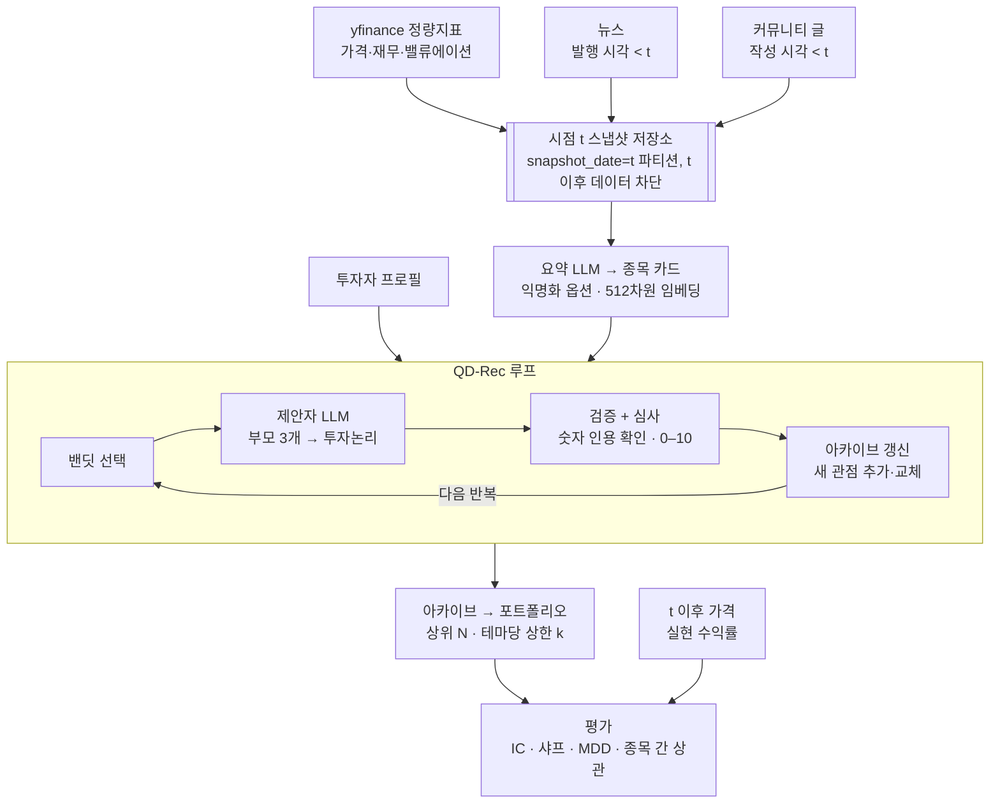

# QD-Rec 기반 주식 아이디어 발굴 시스템 설계

> claude.ai 설계 문서(https://claude.ai/artifact/M1W76ZES5xESSbLq5AcFaL)를 2026-10-24에 내보낸 사본. 이후 변경은 이 파일을 기준으로 한다.

Oct 23, 2026 · @Junhyeong Kim

## 목적과 범위

QD-Rec을 주식에 맞게 확장해, 정량지표와 뉴스·커뮤니티 글로 "종목 + 투자논리" 아카이브를 진화시키고, 그 아카이브가 실제 수익과 분산에 도움이 되는지 포워드 테스트로 검증한다.

**하는 것**

- 투자 아이디어 발굴과 투자논리의 다양화
- 아카이브를 포트폴리오로 바꾸는 고정 규칙
- 사전에 정한 프로토콜에 따른 성능 평가

**하지 않는 것**

- 자동매매, 실시간 매매 신호
- 특정 종목의 매수·매도 권유 (결과는 검토 후보 목록일 뿐)

**연구 질문**

1. RQ1: 심사 LLM의 점수가 이후 실제 초과수익의 순위를 예측하는가?
2. RQ2: 진화(부모 참조)가 매번 새로 쓰는 방식보다 품질·다양성을 높이는가? (원 논문 결과의 주식 도메인 재현)
3. RQ3: 투자논리 자체(촉매·반증 조건)가 실제로 맞았는가, 그리고 수익은 논리 적중에서 왔는가 운에서 왔는가?
4. RQ4: 뉴스·커뮤니티 텍스트를 더하면 숫자만 쓸 때보다 RQ1·RQ3가 개선되는가?
5. RQ5: 투자논리 자체(촉매·반증 조건)가 실제로 맞았는가, 그리고 수익은 논리 적중에서 왔는가 운에서 왔는가?

## 개념 매핑

원 저장소의 M&A 앱(`apps/companies`)을 출발점으로, 인수 기업 자리에 투자자를 넣고 후보 회사 자리에 투자 유니버스 종목을 넣는다.

| QD-Rec 구성요소 | 원 논문(M&A) | 이 시스템 | 바뀌는 점 |
| --- | --- | --- | --- |
| 후보(item) | 인수 대상 회사 | 유니버스 내 종목 | 시점 t의 숫자·뉴스·커뮤니티 요약이 붙은 "종목 카드" |
| 프로필 | 인수 기업(예: 디즈니) | 투자자 본인 | 기간·리스크·제약·보유 종목 |
| 가설 | 인수해야 하는 이유 | 투자논리 | 근거 숫자, 촉매, 리스크, 반증 조건을 필수 항목으로 |
| 제안자 LLM | 인수 논리 작성 | 애널리스트 역할 | 카드에 있는 숫자만 인용 가능 |
| 심사 LLM | 인수 논리 채점 | 투자위원회 역할 | 채점 전에 규칙 기반 숫자 검증기를 통과해야 함 |
| 아카이브 | 인수 후보 목록 | 아이디어 워치리스트 | 포트폴리오 변환 규칙의 입력 |
| 새로움 판정킷지역 경쟁 | 관점 중복 제거 | 동일 테마 논리 중복 제거 | 변경 없음 |
| 밴딧 | 다음에 볼 회사 선택 | 리서치 시간 배분 | 변경 없음 |
| (없음) | — | 실현 수익률 평가 | 새로 추가하는 평가 계층 |

## 전체 아키텍처와 데이터 흐름

수집 → 스냅샷 → 종목 카드 → QD-Rec 루프 → 포트폴리오 → 평가의 한 방향 흐름이며, t 이후 데이터는 평가 단계에서만 들어온다.



강조된 스냅샷 저장소가 누출 방지의 경계이고, QD-Rec 루프 내부는 원 저장소 구조를 그대로 쓴다.

## 데이터 계층

모든 데이터는 "스냅샷 시점 t"를 붙여 직접 쌓는다. yfinance는 과거 시점에 알 수 있던 값(point-in-time)을 주지 않으므로, 지금부터 주기적으로 저장한 스냅샷만 신뢰할 수 있는 입력이 된다.

| 소스 | 가져올 것 | 주기 | 시점 규칙 | 주의점 |
| --- | --- | --- | --- | --- |
| yfinance 가격 | 종가, 거래량, 1·3·12개월 수익률, 변동성 | 매일 | t 이전 종가만 | 수정주가 기준으로 통일 |
| yfinance 기본정보·재무 | 시가총액, PER, PBR, 배당률, 매출·이익 성장률, 섹터 | 주 1회 | 스냅샷 저장 시점 값 그대로 보관 | 과거 재무는 몇 년치만 제공, 값이 사후 수정될 수 있음 |
| 뉴스 | 기사 제목·요약, 발행 시각 | 매일 | 발행 시각 < t | yfinance 뉴스는 최근 기사만 제공 → 매일 수집해 누적 필요 |
| 커뮤니티 | 게시글 제목·본문 일부, 작성 시각, 반응 수 | 매일 | 작성 시각 < t | 앱 등록이 필요 없는 소스 우선: StockTwits는 403 차단(2026-10-24 확인)이라 Wikipedia 페이지뷰. Reddit은 보류. 원문은 내부 보관만 |
| 실현 수익률(평가용) | t 이후 1·3개월 초과수익 | 평가 시 | t 이후 데이터는 평가 계층에서만 읽음 | 생성 파이프라인과 코드 경로를 분리 |

**누출 방지 원칙**

- 저장 단위는 `snapshot_date=t` 파티션(Parquet). QD-Rec 파이프라인은 t 파티션 하나만 읽는다.
- 평가 계층만 t 이후 가격을 읽을 수 있게 모듈을 분리하고, 테스트로 강제한다.
- 상장폐지·편입 변경을 기록하기 위해 유니버스 구성도 스냅샷마다 저장한다(생존 편향 방지).

## Item 표현: 종목 카드

종목 하나 = 텍스트 카드 하나이며, 숫자 블록과 요약 블록으로 나눠 제안자와 심사자가 같은 카드를 본다. 원 저장소의 `item_text`가 이 카드를 반환하도록 바꾼다.

```markdown
[종목 C-127] 섹터: 산업재 / 시가총액 구간: 중형 / 스냅샷: 2026-11-02

## 숫자 (t 기준)
- 수익률: 1개월 +4.1%, 3개월 -2.3%, 12개월 +18.0%
- 변동성(60일): 27%
- PER 14.2 / PBR 1.8 / 배당률 2.1%
- 매출 성장률(전년비): +9%, 영업이익률: 12%

## 사업 요약
- (회사 설명 2~3줄, 고유명사 마스킹)

## 최근 뉴스 요약 (최근 30일, 발행 < t)
- 사실: ...
- 해석이 갈리는 점: ...

## 커뮤니티 요약 (최근 30일, 작성 < t)
- 주요 논점: ...
- 분위기: 긍정 / 중립 / 부정 비율, 언급량 변화
```

(위 숫자는 형식 예시이며 실제 데이터가 아니다.)

**설계 규칙**

- **요약 LLM 단계:** 뉴스·커뮤니티 원문은 카드에 직접 넣지 않고, 별도 요약 LLM이 "사실 / 의견 / 분위기"로 나눠 요약한다. 요약 프롬프트는 숫자를 새로 만들지 않도록 제한한다.
- **익명화 모드(백테스트용):** 회사명·티커·제품명을 `C-127` 같은 ID로 바꾸고, 시가총액은 구간으로만 표시한다. LLM의 사전 지식으로 결과를 "기억"하는 효과를 줄이기 위함이다.
- **실명 모드(포워드 테스트용):** 실명을 유지해 더 풍부한 논리를 허용한다. 두 모드의 차이 자체가 평가 항목이 된다.
- **길이 상한:** 카드당 약 1,500토큰. 넘으면 뉴스·커뮤니티 요약부터 줄인다.
- **임베딩:** 원 저장소와 같이 카드 텍스트를 512차원으로 임베딩해 아카이브 이웃 검색에 쓴다.

## 프로필 설계

프로필은 실험 내내 고정하는 텍스트 한 덩어리이며, 제안자와 심사자 프롬프트 양쪽에 그대로 들어간다. 원 저장소의 `profiles.py` 딕셔너리에 항목을 추가하는 방식을 따른다.

| 항목 | 내용 | 예시 |
| --- | --- | --- |
| 투자 기간 | 보유 예정 기간 | 3\~12개월 |
| 목표 | 성장, 배당, 방어, 혼합 중 무엇을 원하나 | 시장 대비 초과수익, 낙폭은 시장 수준 |
| 리스크 한도 | 감내 가능한 손실, 변동성 | 단일 종목 -30%면 재검토 |
| 제약 | 제외 섹터·종목, 최소 시가총액, 유동성 | 시가총액 하위 구간 제외 |
| 현재 보유 | 이미 가진 종목과 대략 비중 | 대형 기술주 비중이 높음 |
| 선호하는 근거 | 어떤 종류의 논리를 신뢰하나 | 실적 숫자로 확인 가능한 논리 |

- 비교 실험용으로 성향이 다른 프로필 2개(예: 성장 지향, 방어 지향)를 둔다. 원 논문도 도메인마다 프로필 2개로 실험했다.
- 프로필을 바꾸면 아카이브를 처음부터 다시 만든다. 실행 중 수정은 비교를 무의미하게 만든다.

## 가설 생성과 심사

투자논리는 정해진 양식으로 쓰게 하고, 심사 전에 규칙 기반 검증기로 카드에 없는 숫자를 걸러낸다. 그럴듯한 문장이 아니라 확인 가능한 논리만 점수를 받게 하는 것이 목적이다.

**제안자 입력**

- 프로필, 선택된 종목 카드, 아카이브에서 뽑은 부모 3개(원 논문 설정과 같은 m=3)
- 지시: 부모의 관점을 변형(mutate)하거나 2개를 결합(crossover)해 이 종목에 맞는 새 논리 작성

**제안자 출력 양식 (JSON)**

| 필드 | 내용 |
| --- | --- |
| thesis | 투자논리 2\~4문장 |
| evidence | 카드에서 인용한 숫자·사실 목록(원문 그대로) |
| catalyst | 논리가 실현될 계기 |
| risks | 주요 리스크 1\~3개 |
| falsifier | 이 논리가 틀렸다고 판단할 조건 |
| horizon | 1개월 / 3개월 / 12개월 중 하나 |

**검증기 (규칙 기반, LLM 아님)**

- `evidence`의 숫자가 카드에 실제로 있는지 문자열·수치 비교로 확인한다.
- 하나라도 없으면 심사 없이 0점 처리하고, 실패율을 따로 기록한다.

**심사 기준 (0\~10점, 항목별 점수 후 합산)**

| 기준 | 배점 | 보는 것 |
| --- | --- | --- |
| 근거 일치 | 3 | 인용 근거가 논리를 실제로 뒷받침하는가 |
| 프로필 적합 | 3 | 기간·리스크·제약·보유 종목과 맞는가 |
| 리스크·반증 명시 | 2 | 리스크와 반증 조건이 구체적인가 |
| 촉매의 구체성 | 2 | 언제, 무엇으로 확인 가능한가 |

- 새로움은 심사 기준에 넣지 않는다. 새로움 판정은 아카이브 갱신 단계가 따로 맡는다(원 논문 구조와 동일).
- 제안자와 심사자는 서로 다른 모델 계열을 권장한다. 같은 모델이면 자기 글에 후한 점수를 줄 수 있다.
- 심사 점수는 "논리의 질"이지 수익 예측이 아니다. 둘의 관계는 평가 단계의 RQ1에서 따로 측정한다.

## 아카이브 → 포트폴리오 변환

아카이브는 사람의 판단 없이 고정 규칙으로 포트폴리오가 되어야 평가가 성립한다. 규칙은 실험 시작 전에 확정하고 바꾸지 않는다.

1. **종목 점수 집계:** `status=active`인 엔트리만 사용. 종목별 최고 점수와 엔트리 수(서로 다른 논리 수)를 계산한다.
2. **논리 클러스터링:** 투자논리 임베딩을 군집화해 "테마"를 만든다(예: k-means, k는 고정).
3. **선택:** 점수 순으로 상위 N종목을 뽑되, 한 테마에서 최대 k종목까지만 허용한다. N과 k는 결정 필요 항목.
4. **비중:** 기본은 균등 비중, 비교용으로 점수 비례 비중. 종목당 상한(예: 10%)을 둔다.
5. **리밸런싱:** 월 1회. 새 스냅샷으로 카드를 갱신하고, 직전 아카이브의 active 엔트리를 시드로 이어서 탐색한다.

- 테마 상한(3번)이 RQ3의 핵심 장치다. "논리 다양성 → 실제 분산" 가설을 바로 이 규칙으로 검증한다.
- 평균-분산 최적화 같은 정량 기법은 2단계 확장으로 미루고, 1단계는 단순 규칙으로 효과를 분리해 본다.

## 평가 설계

주 평가는 포워드 테스트(지금부터 가상 운용)이고, 백테스트는 익명화 모드로만 돌리는 보조 평가다. LLM이 과거 주가 흐름을 학습 데이터로 이미 알고 있어 일반 백테스트는 성적이 부풀려지기 때문이다.

**평가 경로**

| 구분 | 기간 | 카드 모드 | 신뢰도 | 용도 |
| --- | --- | --- | --- | --- |
| 포워드 테스트 | 시작일부터 최소 6개월 | 실명 | 높음 | 최종 결론 |
| 익명화 백테스트 | 사용 모델의 학습 시점 이후 기간만 | 익명화 | 중간 | 파이프라인 점검, 빠른 반복 |
| 일반 백테스트 | 과거 전체 | 실명 | 낮음 | 하지 않음(누출 크기 확인용으로만 1회) |

**비교 대상 (같은 유니버스, 같은 리밸런싱 주기)**

| 비교 대상 | 무엇을 확인하나 |
| --- | --- |
| 벤치마크 지수 | 시장 대비 성과 |
| 유니버스 균등 비중 | 종목 선택의 효과 |
| 단순 팩터(12-1개월 모멘텀, 저PER) | LLM 없이도 되는 수준 |
| Novelty (진화 없음) | RQ2: 진화의 효과 |
| Novelty+Evo (밴딧 없음) | 밴딧의 효과 |
| QD-Rec, 숫자만 | RQ4의 기준선 |
| QD-Rec, 숫자 + 뉴스·커뮤니티 | 제안 방식 |
| QD-Rec, 테마 상한 없음 | RQ3: 다양성 규칙의 효과 |

### 평가 관점: 개별 종목과 포트폴리오

평가는 두 층으로 나눈다. 개별 종목 층은 "아이디어가 맞았나"를, 포트폴리오 층은 "그 아이디어로 돈을 벌고 위험을 줄였나"를 본다.

**개별 종목 (아이디어 단위)**

| 관점 | 질문 | 지표 | RQ |
| --- | --- | --- | --- |
| 점수의 예측력 | 높게 평가한 종목이 더 올랐나 | IC: 심사 점수와 이후 1·3개월 초과수익의 스피어만 순위 상관, 시점별 평균과 t값 | RQ1 |
| 상위·하위 격차 | 고득점 그룹이 저득점 그룹을 이겼나 | 점수 5분위별 평균 초과수익, 1분위 − 5분위 차이 | RQ1 |
| 기간 일치 | 제시한 기간에 맞게 움직였나 | horizon(1·3·12개월)별 IC | RQ1 |
| 논리 적중률 | 투자논리 자체가 맞았나 | 촉매 실현률, 반증 조건 발생률 | RQ5 |
| 논리 × 수익 | 실력이었나 운이었나 | 아래 4분면의 비율 | RQ5 |
| 근거 정확성 | 숫자를 지어내지 않았나 | 검증기 실패율 | 품질 관리 |

**논리 × 수익 4분면**

|  | 초과수익 > 0 | 초과수익 ≤ 0 |
| --- | --- | --- |
| 논리 적중 | 실력: 맞아서 벌었다 | 시장이 이미 반영했거나 아직 반영 전 |
| 논리 빗나감 | 운: 틀렸는데 벌었다 | 정직한 실패 |

좋은 시스템은 "실력" 칸 비율이 비교 대상보다 높고, "운" 칸 비율이 낮아야 한다. 수익률만으로는 이 둘을 구분할 수 없다.

**논리 적중 판정 방법**

- 판정 시점: 각 논리의 horizon 종료일. 포워드 테스트 6개월 안에서는 1·3개월 논리만 판정 가능하다.
- 판정 입력: 원래 투자논리와 t 이후의 뉴스·실적 요약.
- 블라인드: 판정자에게 주가 결과와 원래 심사 점수를 보여주지 않는다. 주가를 알면 결과에 맞춰 판정하기 쉽기 때문이다.
- 판정자: 별도 LLM 판정자 + 무작위 10% 표본은 사람이 재판정해 일치율을 보고한다.
- 라벨: 촉매 실현 / 부분 실현 / 미실현 / 판정 불가, 반증 조건 발생 여부(예/아니오).
- 판정 불가 비율이 높으면 촉매가 모호하게 쓰였다는 뜻이므로, 심사 기준의 "촉매 구체성" 항목이 제대로 작동하는지 점검하는 신호로 쓴다.

**포트폴리오 (규칙 적용 결과)**

| 관점 | 질문 | 지표 | RQ |
| --- | --- | --- | --- |
| 수익 | 비교 대상보다 벌었나 | 거래비용 차감 후 초과수익, 정보비율 | 전체 |
| 위험 조정 | 위험 대비 효율적이었나 | 샤프 비율, 변동성, 최대 낙폭 | 전체 |
| 분산 | 논리 다양성이 실제 분산으로 이어졌나 | 평균 종목 간 상관, 보유 테마 수, 섹터 집중도(HHI) | RQ3 |
| 수익 원천 | 수익이 어디서 왔나 | 종목·테마별 수익 기여, 시장·규모·가치·모멘텀 팩터 노출 회귀 | 전체 |
| 운용 현실성 | 실제로 굴릴 수 있나 | 회전율, 거래비용 민감도(편도 0.1% / 0.3%) | 전체 |
| 탐색 건전성 | 아카이브가 잘 만들어졌나 | 품질·다양성·커버리지(원 논문 정의) | RQ2 |

팩터 노출 회귀는 "초과수익이 사실 모멘텀 종목을 많이 담은 결과일 뿐인가"를 걸러낸다. 팩터로 설명되지 않는 잔여 수익(알파)이 있어야 LLM 논리의 기여로 볼 수 있다.

- 월간 리밸런싱 6개월이면 포트폴리오 수익률 비교는 6개 시점뿐이라 통계적 결론이 약하다. 종목 단위인 IC가 표본 수가 많아 1차 판단 지표가 된다.
- LLM 출력은 매번 달라지므로 같은 설정을 최소 3회 반복해 평균과 분산을 보고한다.
- 평가 규칙(지표, 기간, 비교 대상)은 첫 실행 전에 이 문서에 고정한다.

## 리포지토리 구조와 구현 단계

원 저장소를 포크해 `apps/stocks/`를 새 앱으로 추가하고, 데이터 수집과 평가는 QD-Rec 코어와 분리된 모듈로 둔다.

```
QD-Rec/                    # SakanaAI/QD-Rec 포크
├─ shared/                 # 원본 코어(아카이브, 밴딧, 뷰어) — 최소 수정
├─ apps/stocks/
│  ├─ config.py            # 모델, 유니버스, 반복 횟수
│  ├─ profiles.py          # 투자자 프로필
│  ├─ items.py             # 종목 카드 생성 (item_text)
│  ├─ prompts.py           # 제안자·심사자·요약 프롬프트
│  ├─ verifier.py          # 숫자 인용 검증기
│  ├─ seed.py / qd_rec.py  # 원본과 같은 진입점
├─ ingest/                 # 데이터 수집 (QD-Rec과 독립)
│  ├─ prices.py, fundamentals.py   # yfinance
│  ├─ news.py, community.py
│  └─ snapshot.py          # snapshot_date=t 파티션 저장
├─ portfolio/
│  └─ build.py             # 아카이브 → 포트폴리오 규칙
└─ evaluation/             # t 이후 가격은 여기서만 읽음
   ├─ metrics.py           # IC, 샤프, MDD, 상관
   ├─ baselines.py         # 지수, 균등, 팩터
   └─ report.py
```

**구현 단계**

1. M0 재현: 원 저장소의 논문 추천 앱을 그대로 돌려 환경과 비용 감을 잡는다.
2. M1 수집: `ingest/`로 가격·재무·뉴스·커뮤니티 일일 스냅샷 저장을 시작한다. 포워드 테스트용 데이터가 쌓이므로 가장 먼저 돌려야 한다.
3. M2 카드: 요약 LLM과 종목 카드, 익명화 모드, 임베딩.
4. M3 생성·심사: 프롬프트, 검증기, 심사 기준. 소규모(종목 50개, 100회 평가)로 출력 품질을 눈으로 점검한다.
5. M4 포트폴리오: 변환 규칙과 리밸런싱 루프.
6. M5 평가 하니스: 지표, 비교 대상, 익명화 백테스트로 파이프라인 검증.
7. M6 포워드 테스트: 평가 규칙을 고정하고 월간 운영 시작, 6개월 후 결론.

## 저예산 PoC 계획

PoC는 "이 방식이 본 실험에 돈을 쓸 가치가 있는가"만 판단한다. LLM을 쓰지 않는 검증을 먼저 끝내고, LLM 호출은 규모·변형·반복 수를 줄여 본 설계의 약 1/10 이하로 맞춘다.

**본 설계 대비 축소**

| 항목 | 본 설계 | PoC |
| --- | --- | --- |
| 유니버스 | 300\~500종목 | 미국 대형주 100종목 |
| 반복 횟수(1회 실행) | 1,000회 평가 | 300회 평가 |
| LLM 변형 | 5종 | 3종: Novelty, QD-Rec(숫자만), QD-Rec(숫자+뉴스) |
| 반복 실행 | 3회 | 2회 |
| 커뮤니티 데이터 | 포함 | 제외 (확장 실험으로 미룸) |
| 모델 | 제안자·심사자 고성능 | 전부 저가 모델, 단 제안자와 심사자는 다른 계열 |
| 포워드 기간 | 6개월 | 3개월, 월 1회 리밸런싱 |
| 논리 적중 판정 | 전수 + 사람 10% | 1개월 논리 무작위 50건 |

LLM이 필요 없는 비교 대상(지수, 균등 비중, 모멘텀·저PER 팩터)은 비용이 0이므로 전부 유지한다.

**비용 절감 장치**

- 뉴스 요약은 종목·스냅샷당 1회만 만들고 캐시한다. 같은 카드를 모든 변형이 공유한다.
- 프로필과 지시문을 프롬프트 앞부분에 고정해 프롬프트 캐싱을 적용한다.
- 출력은 JSON으로 짧게 제한한다(투자논리 2~4문장).
- 예산 상한에 닿으면 실행을 멈추는 비용 카운터를 둔다.

**호출량 어림 (실행 1회)**

- 평가 1회 ≈ 제안 1 + 새로움 판정 1 + 품질 심사 1 = LLM 호출 3회.
- 300회 평가 × 3 = 약 900회 호출, 호출당 입력 약 3천 토큰 가정 시 입력 약 270만 토큰.
- 월 호출 수 ≈ 900 × 3변형 × 2반복 = 약 5,400회 + 요약 100회. 실제 금액은 선택한 모델 단가를 곱해 M3에서 실측한다.

**단계와 통과 기준**

1. A단계, LLM 없이 (1주): 데이터 수집, 스냅샷 누출 테스트, 팩터 베이스라인 계산. 통과 기준: t 이후 데이터 접근 테스트 0건 실패.
2. B단계, 오프라인 품질 점검 (1~2주, 저비용): 종목 30개·100회 평가로 출력 확인. 통과 기준: 검증기 실패율 5% 미만, QD-Rec 아카이브의 다양성이 Novelty 이상.
3. C단계, 학습 마감일 이후 백테스트 (며칠): 아래 "백테스트로 전환" 참고. 통과 기준: QD-Rec의 평균 IC가 0보다 크고 Novelty보다 높음, 포트폴리오 3개월 초과수익이 Novelty와 균등 비중 이상.
4. D단계, 포워드 테스트: 2026-10-23부터 쌓는 실수집 데이터로 계속 운영하고, 뉴스 효과(RQ4)와 백테스트 결과의 유지 여부를 후속으로 확인한다.

PoC의 통과는 "효과가 있다"가 아니라 "본 실험을 할 근거가 있다"는 뜻으로만 해석한다.

**백테스트로 전환 (2026-10-24 결정)**

개인 프로젝트로 결과를 빨리 공개하기 위해, 3개월 포워드 테스트 대신 과거 시점 백테스트를 PoC의 주 검증으로 삼는다. 과거 데이터의 두 가지 누출은 이렇게 막는다.

- **모델의 사전 지식:** 학습 마감일이 공개된 저가 모델만 쓰고(제안자 `google/gemini-2.5-flash-lite` 2025-01-31, 심사자 `openai/gpt-5-nano` 2024-05-31), 스냅샷은 그 이후 날짜만 쓴다. 기본 날짜는 2025-03-31부터 2026-06-30까지 분기 말 6개다. 모델은 t 이후에 일어난 일을 알 수 없다.
- **데이터의 시점:** 가격은 t 이전 종가만 쓴다. 재무는 연간 재무제표 중 회계연도 종료 후 60일(대형 기업의 10-K 제출 기한)이 지난 것만 t의 값으로 쓰고, 시가총액은 현재 주식 수 × t 종가로 다시 계산한다(`ingest/backfill.py`).

알려진 한계:

- 과거 뉴스는 Yahoo가 주지 않아 Google News RSS 검색(기간 지정, 등록 불필요)에서 제목·매체·날짜를 받는다(`ingest/news_history.py`). RSS의 시각은 믿을 수 없어 t 당일 기사는 빼고 t 전날까지만 쓴다. 본문은 없고 제목만 있다. 오늘의 검색 순위가 어떤 과거 기사를 돌려줄지 정하므로, 나중에 중요해진 기사가 더 잘 잡힐 수 있다. GDELT는 이 환경에서 요청 제한(429)으로 막혀 쓰지 않았다.
- 변형은 설계대로 세 가지: Novelty(숫자+뉴스), QD-Rec(숫자만), QD-Rec(숫자+뉴스). 카드의 뉴스 칸은 `WITH_NEWS=0`으로 끈다.
- 유니버스는 오늘의 S&P 100 구성을 모든 t에 쓴다(생존 편향). 모든 방식이 같은 유니버스를 쓰므로 방식 간 비교에는 영향이 작지만, SPY 대비 절대 수익은 부풀 수 있다.
- 사업 요약은 오늘 받은 설명이라 t 이후 사건이 일부 섞일 수 있다.
- 주식 수 변화(자사주 매입 등)를 무시해 PER·PBR이 몇 % 어긋날 수 있다.
- 분기 6개는 통계적 결론에는 적다. 결과는 PoC 수준의 신호로만 쓴다.

비교 대상: SPY, 균등 비중 유니버스, 12-1 모멘텀 상위 20(섹터당 3). 포트폴리오는 아카이브의 종목별 최고 점수 상위 20, 섹터당 3, 동일 비중, 왕복 비용 0.2% 차감.

## 리스크와 결정 필요 항목

가장 큰 리스크는 "점수는 높지만 수익과 무관한" 결과이며, 이는 실패가 아니라 RQ1의 답으로 보고한다.

| 리스크 | 영향 | 대응 |
| --- | --- | --- |
| 미래 정보 누출 | 성과 과대평가 | 포워드 테스트 우선, 익명화, 스냅샷 파티션 강제 |
| 숫자 지어내기 | 근거 없는 논리가 고득점 | 규칙 기반 검증기, 실패율 모니터링 |
| 심사자의 자기 선호 | 점수 부풀림 | 제안자와 다른 모델 계열 사용 |
| 커뮤니티 데이터 품질·약관 | 노이즈, 수집 중단 | 요약 단계에서 사실·의견 분리, 소스별 약관 확인 |
| 짧은 평가 기간 | 결론의 통계적 약함 | IC 중심 판단, 반복 실행, 기간 연장 |
| LLM 호출 비용 | 실험 축소 | 소규모로 단가 측정 후 유니버스·반복 횟수 결정 |

**결정 필요**

- [x] 시장 → 결정: 미국
- [ ] 유니버스 크기: PoC는 S&P 100, 본 실험은 300 / 500종목 중 결정
- [ ] 제안자·심사자·요약 모델 조합
- [x] 커뮤니티 소스 → 앱 등록이 필요 없는 것 우선. Reddit은 보류, StockTwits는 403 차단(2026-10-24 확인)이라 Wikipedia 페이지뷰(관심도)로 대체
- [ ] 포트폴리오 N(종목 수)과 테마당 상한 k (추천 N=20, k=3)
- [ ] 월 예산(LLM 호출 비용 상한)
- [ ] 포워드 테스트 시작일
